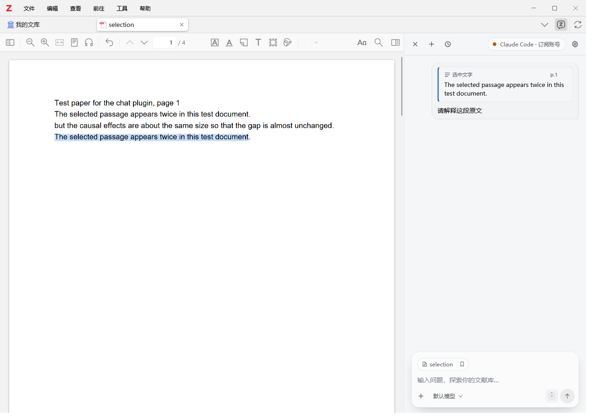

# Zotero Agent (Unofficial Bilingual / Simplified Chinese Derivative)

[简体中文](README.md) | **English**

**Prerelease fix 0.15.2.15** creates the chat collection before the first WebDAV upload and updates standalone Zotero settings when sync succeeds or fails. [Download the fix](https://github.com/SchallyHsu/zotero-agent-zh-CN/releases/tag/zh-CN-v0.15.2.15). Initial upload and repeated sync were verified with an existing Windows/WebDAV deployment; complete cross-device continuation still needs multi-device validation.

**Prerelease 0.15.2.14** adds **bidirectional WebDAV chat sync and cross-device continuation**. Devices share one conversation transcript, rebuild local model context after remote replies, upload offline changes and preserve concurrent branches. [Download the test XPI and source archive](https://github.com/SchallyHsu/zotero-agent-zh-CN/releases/tag/zh-CN-v0.15.2.14). See [Chat sync](docs/chat-sync.md) for setup and validation. Actual two-computer use and your WebDAV provider still need validation after configuration.

**0.15.2.13** fixes the **DeepSeek Harness quota panel**: dsh 0.2.2 reports ACP model values as `["provider","model"]` JSON selectors, so the plugin now queries the route actually selected — `deepseek-account` (platform recharge / bonus wallets) or `deepseek-official` (API-key balance) — instead of reporting "cannot determine the account". The **selected source text and page numbers** from 0.15.2.12 remain: click a passage to return to its exact PDF position and **temporarily highlight it**, including after restoring a saved chat. Live **Chinese / English switching**, quota gauges, and Codex, Claude Code, Antigravity, DeepSeek Harness and pi support remain available. See the [Changelog](CHANGELOG.md) and [Account Quota & Usage](docs/account-usage.md).

An **unofficial derivative** of the Zotero Agent plugin from [54yyyu/zotero-mcp](https://github.com/54yyyu/zotero-mcp). This repository adds bilingual UI support (Simplified Chinese & English), project and per-paper conversation management, native backend integrations (Antigravity CLI & DeepSeek Harness), account quota & usage gauges, and localization performance optimizations. Core agent sessions, library access, chat, and tool calls come from the upstream project and its contributors.

**Upstream release:** [v0.15.2](https://github.com/54yyyu/zotero-mcp/tree/v0.15.2/plugin) · **Upstream commit:** [`dfec70c8b772e697476e0b42c1264441cf518686`](https://github.com/54yyyu/zotero-mcp/commit/dfec70c8b772e697476e0b42c1264441cf518686) · **Current prerelease:** `0.15.2.15` · **Stable:** `0.15.2.13`

This project is not an official Zotero or Zotero MCP release and does not imply endorsement by the original author.

## Download & Installation

1. Download `zotero-agent-zh-CN-0.15.2.13.xpi` from [Releases](https://github.com/SchallyHsu/zotero-agent-zh-CN/releases/tag/zh-CN-v0.15.2.13) (checksums in `SHA256SUMS.txt`).
2. In Zotero, open **Tools → Plugins**, click the gear icon, choose **Install Plugin From File…**, select the `.xpi` file, and restart Zotero if prompted.
3. Open the side panel from the toolbar button and complete the `zotero-cli` and backend setup as described in the [upstream plugin documentation](https://github.com/54yyyu/zotero-mcp/blob/v0.15.2/docs/chat-plugin.md).
4. To switch the interface language between **Chinese (`中文`)** and **English**, open **Settings (gear icon) → Appearance → Language**.

This build keeps the upstream add-on ID `chat@zotero-mcp`, so installing it replaces the official plugin in place. You can reinstall the official `.xpi` at any time.

**Compatibility:** Upstream targets Zotero 7+. Desktop verification for this derivative was conducted on Windows 11 with Zotero 10.0.7.

## Key Additions Over Upstream `v0.15.2`

### 1. Live Bilingual Interface (`中文` / `English`)
- **Settings → Appearance → Language**: Switch live between **Simplified Chinese (`中文`)** and **English** without restarting Zotero.
- Paper titles, DOIs, library search hits, user/assistant prose, input values, saved prompts, model/permission IDs, and command outputs are strictly protected and never altered by UI localization.

### 2. Quota & Usage Gauge
- A compact circular gauge + rounded-diamond icon in the composer toolbar shows the remaining share of the tightest active quota window (`≤ 30%` amber warning, `≤ 10%` red alert).
- Hover or focus displays a dark pill summary (e.g. `5h · 73% left` / `5小时 · 剩余 73%`).
- Clicking opens the detailed breakdown popover:
  - **Codex / Claude Code / Antigravity**: Subscription rate-limit windows, remaining percentage, plan name, and local reset time.
  - **DeepSeek Harness (`dsh`)**: Native account top-up and granted balances, or third-party provider quotas when a `<provider>/<model>` is selected.
  - **`pi`**: Queries the active model's provider credentials (`anthropic`, `openai-codex`, `github-copilot`, `google-gemini-cli`, `google-antigravity`, `deepseek`).
  - **Conversation Usage**: Input/output tokens for the last turn and current conversation, turns reporting tokens, and optional estimated API cost.

### 3. Projects & Per-Paper Conversations
- **Settings → Projects and conversations**: Group new chats under a named project (default `Zotero Agent`) and link them to the paper you are reading.
- **Automatic Resume**: Opening a paper automatically restores your most recent conversation for that paper and backend (can be toggled in Settings).
- **Native Client Synchronization**:
  - **Codex**: Syncs project folders and thread titles via `codex app-server` and registers projects in the Codex desktop sidebar after desktop exit.
  - **Claude Code / `pi`**: Organizes conversations by project folder and syncs session titles.
  - **Antigravity**: Creates and resumes native App project conversations shared with `agy acp`, migrating legacy CLI sessions via consistent snapshots.
  - **DeepSeek Harness (`dsh`)**: Attaches sessions to native `WorkspaceRegistry` projects through a local companion extension.

### 4. Original Selections & PDF Navigation

- Selected text and page numbers appear in the composer and sent messages. Long passages are kept in full and can be scrolled and copied.
- Click a passage, or focus its card and press Enter, to return to the PDF selection and highlight it for about two seconds. No permanent annotation is created.
- Saved coordinates distinguish identical sentences on the same page and survive history restoration. Older records fall back to searching their saved text; an unmatched passage still opens its page.
- Selecting text inside a card for copying does not trigger navigation. Source text is protected from UI localization and is rendered as plain text.



## Building from Source

Requires Node.js 24+, npm, and `zip` on `PATH`:

```bash
git clone https://github.com/SchallyHsu/zotero-agent-zh-CN.git
cd zotero-agent-zh-CN
npm ci
npm run typecheck
npm run build
```

The installable add-on is written to `dist/zotero-agent.xpi`. The exact source for this release is available under tag `zh-CN-v0.15.2.13` and in the source ZIP attached to its GitHub Release.

## Verification & Development Preview

```bash
npx playwright install chromium
npm test
npm run test:performance
```

`npm test` runs TypeScript type-checking, builds the standalone preview (`preview/dist/index.html`), and runs unit + headless browser suites covering UI localization, live language switching, per-paper conversation lifecycle, native backend adapters, quota/usage gauges, and source selection display and navigation using synthetic test data.

`npm run test:selection` runs the focused selection checks. `npm run test:xpi-selection` also checks the packaged XPI in a temporary Zotero profile and library, including real PDF highlighting and restored history, without model inference. Set `ZMC_ZOTERO_BIN` to your Zotero executable if needed (the Windows default is `D:\Zotero\zotero.exe`). The upstream full suite still has Windows symlink-permission and path-assertion limitations; see [Validation](docs/VALIDATION.md).

## License & Attribution

Distributed under **AGPL-3.0-or-later** (see [LICENSE](LICENSE), [NOTICE.md](NOTICE.md), [SOURCE.txt](SOURCE.txt), and [THIRD_PARTY_NOTICES.md](THIRD_PARTY_NOTICES.md)). Original plugin design and implementation credit belongs to [54yyyu/zotero-mcp](https://github.com/54yyyu/zotero-mcp).
