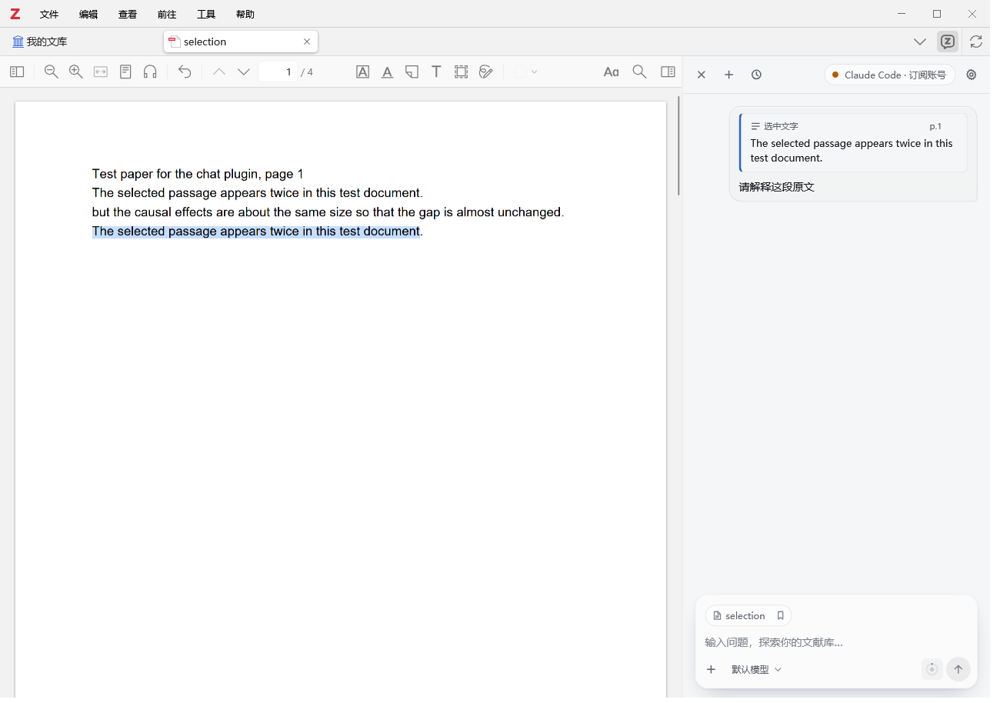
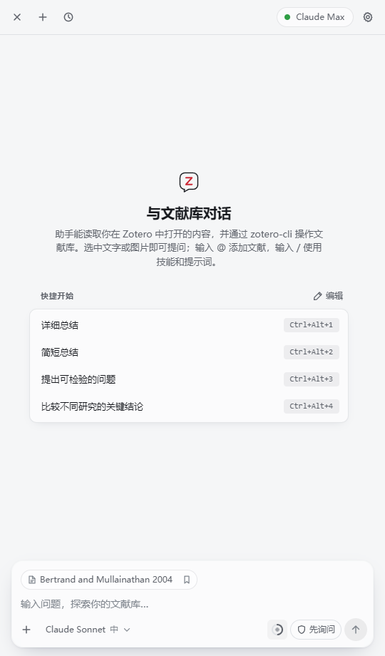
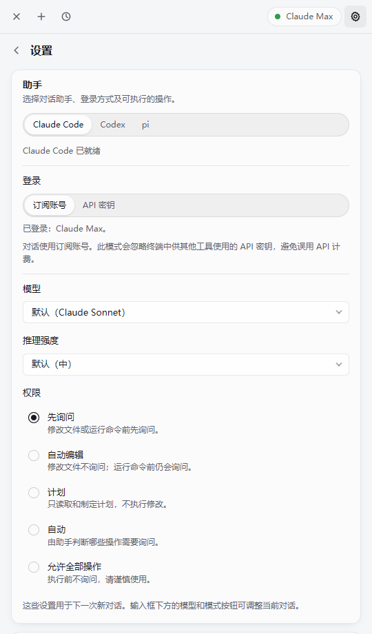

# Zotero Agent（非官方）

**简体中文** | [English](README.en.md)

**0.15.2.13** 修复 **DeepSeek Harness 的“额度与用量”**：dsh 0.2.2 的 ACP 模型值是 `["provider","model"]` 形式的 JSON 选择器，插件现在按 `deepseek-account`（平台账号充值／赠送余额）、`deepseek-official`（API 密钥余额）等实际路由查询，不再提示“无法确定账号”。同时保留 0.15.2.12 的**选区原文与页码**：点击原文即可返回 PDF 对应选区并**临时高亮**，恢复历史对话后也能继续定位。继续支持**中文／English 实时切换**、额度与用量仪表，以及 Codex、Claude Code、Antigravity、DeepSeek Harness 和 pi。完整改动见 [更新记录](CHANGELOG.md)，额度功能与验证边界见 [额度与用量说明](docs/account-usage.md)。

基于 [54yyyu/zotero-mcp](https://github.com/54yyyu/zotero-mcp) 的 Zotero Agent 插件制作的**非官方简体中文衍生版**。本仓库增加界面汉化、项目与文章对话管理、后端适配和性能优化；原插件的模型接入、文献读取、对话、工具调用等核心功能来自原项目及其贡献者。

**上游版本：** [v0.15.2](https://github.com/54yyyu/zotero-mcp/tree/v0.15.2/plugin) · **上游提交：** [`dfec70c8b772e697476e0b42c1264441cf518686`](https://github.com/54yyyu/zotero-mcp/commit/dfec70c8b772e697476e0b42c1264441cf518686) · **本版：** `0.15.2.13`

本项目不是 Zotero 或 Zotero MCP 官方发布，不代表原作者背书。请先了解原项目，并将通用功能问题与本仓库的汉化问题区分开。

## 下载与安装

1. 从 [Releases](https://github.com/SchallyHsu/zotero-agent-zh-CN/releases/tag/zh-CN-v0.15.2.13) 下载 `zotero-agent-zh-CN-0.15.2.13.xpi`，校验文件为 `SHA256SUMS.txt`。
2. 打开 Zotero → **工具 → 插件**，点击齿轮，选择“从文件安装插件”，选取 `.xpi`；按提示重新启动 Zotero。
3. 从工具栏“文献助手”按钮打开侧栏，完成原插件要求的 `zotero-cli` 和模型后端配置。详细要求见 [上游插件文档](https://github.com/54yyyu/zotero-mcp/blob/v0.15.2/docs/chat-plugin.md)。

插件保留原 ID `chat@zotero-mcp`，因此会替换已安装的官方插件，不能与其并行安装。安装前可正常退出 Zotero，并备份原 `.xpi`；需要恢复时重新安装官方版本。本项目不会提供或更改你的账号配置。

**兼容性：** 上游声明支持 Zotero 7+，实际桌面验证环境为 Windows 11 / Zotero 10.0.7；其他平台及版本尚未逐一实测。

**更新行为：** 保留上游自动更新地址。未来官方版本更新可能将界面恢复为英文；本仓库没有独立的自动更新服务。

## 选区原文与定位

- 在 Zotero 阅读器中选择文字后，输入框上方会直接显示原文及页码，发送后的消息中也会保留。
- 点击卡片中的原文即可打开对应 PDF、返回选区并临时高亮约 2 秒，不创建永久批注；也支持键盘聚焦后按回车。
- 长选区可滚动查看，原文完整保存在对话中；拖选卡片中的文字可复制，不会触发跳转。
- 历史对话保留选区坐标，同页重复句子也能准确定位。旧记录没有坐标时按已保存原文查找；无法匹配时跳转到对应页。



## 项目与文章对话

- 设置 → **项目与对话**：项目名称默认 `Zotero Agent`，新会话在“对话目录”下的同名子目录运行；改名后新对话进入新项目，旧对话仍在原项目续聊。
- 历史对话默认按**项目／文章**分组；铅笔按钮可重命名，支持原生改名的后端会自动同步名称。同步失败时显示警告按钮，悬停查看原因，点击重试；本地记录仍保留改名。DeepSeek Harness 的改名目前保存在插件内。
- 打开文章默认恢复与当前后端上次打开的对话；可用“新建对话”为同文另开一段。关闭设置中的自动恢复开关可保持手动切换。回复生成中不会被文章切换打断，完成后恢复目标文章会话。
- 文章以文献库 ID 和父条目 key 关联，多份 PDF 属于同一条目时归到同文，跨库同 key 分开。旧历史从首条用户消息中的文章上下文补全；不明确的保留为通用对话。
- **Codex**：通过本机 `codex app-server` 同步项目、会话名称及项目归属，复用 ACP 会话 ID，不复制对话正文。同名的插件项目复用同一后端项目，旧目录和新目录合并为它的工作根目录。项目接口为实验接口，需要客户端版本支持 `project/list`、`project/create`、`project/update` 和 `thread/metadata/update.projectId`；本机已用隔离配置验证，不支持时会显示失败原因。会话命名接口见 [官方 app-server 文档](https://developers.openai.com/codex/app-server)。
- **Codex 桌面侧栏**：除 app-server 记录外，桌面另有本地项目目录。插件首次登记会等待桌面完全退出后备份并合并侧栏目录；请退出后等待约 5 秒再打开。已有项目及无关会话归属保留，状态可在历史页刷新。
- **Claude Code / pi**：以项目工作目录组织会话，用 ACP bridge 已安装的 SDK 重命名。Claude Code 会重新读取原生目录项目确认名称和归属，已使用真实官方 SDK 验证。旧会话保留原始目录，新会话进入设置中的项目子目录。这些目录项目不等同于 Claude 网页版 Projects。
- **Antigravity**：安装 App 与 `agy` 后，在原生项目内预建会话，再通过 ACP 接续并共享 App 存储。旧 CLI 对话通过一致性快照和原生分叉接续到项目，原对话保留；名称同步到原生摘要，首条回复前会保持待处理状态。
- **DeepSeek Harness**：通过本地配套扩展同步到 dsh 原生工作区，首次安装后需完全退出并重开 dsh Desktop / Web 宿主一次。之后新会话自动归类，旧会话按原 ID 回填；未收到原生确认时显示待处理状态。
- 项目及历史保存在本机，不通过 Zotero 文献同步。元数据同步不调用模型、不额外发送论文或对话正文。

## 额度与用量

输入框底部工具栏右侧的“额度与用量”环形仪表图标：悬停显示单行胶囊提示，点击可查看详情（Codex、Claude Code、Antigravity 显示额度窗口；DeepSeek Harness 原生账号显示充值／赠送余额；pi／dsh 第三方模型按当前服务商查询，避免串用其他客户端账号）。查询失败会标记上次数据，登录过期会提示刷新登录，不影响继续聊天。

本机已实测 Codex、Antigravity 和 DeepSeek Harness；Claude 成功响应及 pi 服务商分流目前由模拟测试覆盖。部分查询使用客户端兼容接口。详细支持范围、刷新行为和验证结果见 [额度与用量说明](docs/account-usage.md)。

## 汉化内容

- 对话主页、输入提示、菜单、按钮、历史记录、运行状态及设置页。
- 模型、推理强度、权限等界面说明，以及上下文用量、工具步骤、技能和提示词管理的界面标签。
- Zotero 工具栏、设置页入口和阅读器翻译弹窗的界面文案。
- 中文日期格式和常见中文字体回退。

论文题名、DOI、文献搜索结果、用户与助手的正文、输入框已有内容、存储的提示词、模型/权限 ID 和命令输出不做界面翻译。第三方返回的未知错误和部分动态名称可能保留英文。界面汉化也不等于自动翻译论文全文。



<details>
<summary>中文设置页预览（合成测试数据）</summary>



</details>

## 性能改动

最初的本地汉化层会在回复更新时重复遍历正文。本版跳过正文子树，保留复制按钮的界面翻译；合并重复的 DOM 更新，仅处理发生改变的属性，避免翻译自身再次触发扫描，并对常用标签设置有限大小的缓存。

在同一台电脑的无界面 Edge 中，每轮模拟 400 段正文的 50 次更新、各运行三次：旧汉化层累计回调耗时中位数为 **382.5 ms**，优化后为 **4.0 ms**。这是特定合成负载下的汉化层开销，不代表整个 Zotero 的加速比例，也未测量模型或网络耗时。原始结果见 [性能记录](docs/performance-results.json)，可使用下方命令复测。

## 从源码构建

需要 Node.js 24+、npm，以及可在命令行运行的 `zip`。构建方式沿用上游；安装开发依赖时请使用锁文件。

```bash
git clone https://github.com/SchallyHsu/zotero-agent-zh-CN.git
cd zotero-agent-zh-CN
npm ci
npm run typecheck
npm run build
```

生成的安装包为 `dist/zotero-agent.xpi`。完整源码、构建脚本、锁文件、许可证与来源说明均在本仓库中；下载对应的 `zh-CN-v0.15.2.13` 源码标签或 Release 附带的完整源码包可获得该发布版的源码。

## 验证与开发预览

```bash
npx playwright install chromium
npm test
npm run test:performance
```

项目、改名与文章恢复的回归检查包含在 `npm test` 中。本机已安装 Codex CLI 时，可额外运行 `npm run test:native-codex`：在临时 `CODEX_HOME` 中创建合成会话，验证中文改名、不同工作目录复用同一项目以及会话归属；不调用模型，不读写真实 Codex 历史。

`npm test` 会执行类型检查、构建预览并运行界面检查；单独构建预览可运行 `npm run preview`。预览入口为 `preview/dist/index.html`。界面检查覆盖主页、设置、历史、状态、深色主题、动态文案、正文保护、输入值与权限 ID；仅使用合成数据，不读取 Zotero 文献库。生成的报告和截图位于 `test-output/`，不会提交到版本库。

如需使用已安装的 Edge/Chrome，可设置进程环境变量 `BROWSER_EXECUTABLE` 为其可执行文件路径，再运行界面与性能检查。界面检查和性能比较不需要连接模型服务。

默认 `npm test` 覆盖汉化、项目与文章对话管理及后端适配回归；保留的上游完整测试可运行 `npm run test:upstream`，但在本机遇到符号链接权限和跨平台路径断言失败，未宣称全套测试通过。完整边界见 [验证记录](docs/VALIDATION.md)。

选区原文与点击定位的回归包含在 `npm test` 中，也可单独运行 `npm run test:selection`。真实阅读器验证可运行 `npm run test:xpi-selection`（Windows 默认使用 `D:\Zotero\zotero.exe`，其他路径可设置 `ZMC_ZOTERO_BIN`）：在临时配置和独立文献库中加载打包 XPI，验证高亮及历史恢复，不调用模型推理。

## 来源、修改与许可证

1. 原项目为 **[54yyyu/zotero-mcp](https://github.com/54yyyu/zotero-mcp)**。本仓库提取其 `plugin/` 目录，保留原实现、素材、测试与构建文件；来源信息见 [UPSTREAM.json](UPSTREAM.json)。
2. **插件目录明确使用 AGPL-3.0-or-later**。本插件及其汉化、优化改动按同一许可发布，全文见 [LICENSE](LICENSE)。原仓库根目录的 MIT 声明另行保存在 [LICENSES/upstream-root-MIT.txt](LICENSES/upstream-root-MIT.txt)，它不替代插件的 AGPL 许可。
3. 修改日期、文件范围及新旧版本关系见 [NOTICE.md](NOTICE.md) 与 [CHANGELOG.md](CHANGELOG.md)。原作者声明和许可证予以保留；本仓库不将原插件宣称为独立原创。
4. 安装包包含 AGPL 许可证、修改声明、源码获取地址及 [第三方组件声明](THIRD_PARTY_NOTICES.md)，并保留 KaTeX、Marked 的完整 MIT 声明。重新分发时请一并保留相应文件并遵守适用许可。

欢迎将通用改进反馈给上游；界面翻译或本仓库构建问题可在这里提 Issue。请勿在 Issue 中粘贴 API 密钥、账号凭据、私人文献或对话记录。
